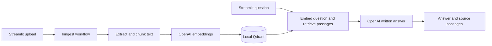

# RAG Pipeline

Upload a PDF or Word document, ask a question, and get a written answer with
numbered references to the source passages. Built with Streamlit, Inngest,
FastAPI, OpenAI, and local Qdrant storage.

**Runs locally. No Docker, AWS account, or hosted database required.**
You need your own OpenAI API key; embedding and answer requests incur API charges.

## What to install

| Requirement | Purpose | Install |
| --- | --- | --- |
| Git | Download and update the repository | [Git](https://git-scm.com/downloads) |
| uv | Install Python and locked Python dependencies | [uv installation](https://docs.astral.sh/uv/getting-started/installation/) |
| Node.js with npm | Run the Inngest development server with `npx` | [Node.js LTS](https://nodejs.org/en/download) |
| OpenAI API key | Create embeddings and generate answers | [API keys](https://platform.openai.com/api-keys) |

Use Python **3.14**, selected by `.python-version`. `uv sync` can install it when
needed. The tested environment is macOS; Windows/Linux have not been tested end
to end. On managed laptops, use your organization's approved installation methods.

## Quick start

### 1. Clone and install

```sh
git clone https://github.com/noelogbuagu/RAG-pipeline.git
cd RAG-pipeline
uv sync --locked
```

This installs the Python packages into `.venv` using `uv.lock`. You do not need
to activate that environment or install packages individually.

### 2. Configure your API key

```sh
cp .env.example .env
```

On Windows PowerShell, use `Copy-Item .env.example .env`. Keep an existing `.env`
if you have already configured this checkout. Open `.env` in your editor and set:

```dotenv
OPENAI_API_KEY=your-own-api-key
```

The account needs API billing/quota and access to `text-embedding-3-large` and
`gpt-5.4-mini`. `OPENAI_ANSWER_MODEL` can select another Responses-compatible
model available to your account. Never commit your key; `.env` is ignored by Git.

### 3. Start the services

Open **three terminals**, each in the repository folder, and leave them running.

**Terminal 1 — backend and database connection**

```sh
uv run uvicorn main:app --reload --host 127.0.0.1 --port 8000
```

**Terminal 2 — background workflows**

```sh
npx --yes inngest-cli@latest dev -u http://127.0.0.1:8000/api/inngest
```

**Terminal 3 — user interface**

```sh
uv run streamlit run streamlit_app.py --server.address 127.0.0.1 --server.port 8501
```

| Service | Link | What to expect |
| --- | --- | --- |
| App | [localhost:8501](http://127.0.0.1:8501) | Upload and question forms |
| Inngest | [localhost:8288/functions](http://127.0.0.1:8288/functions) | Ingest, Query, and Answer Documents functions |
| Database health | [localhost:8000/health/qdrant](http://127.0.0.1:8000/health/qdrant) | `status: ok`; zero collections is normal before ingestion |
| API docs | [localhost:8000/docs](http://127.0.0.1:8000/docs) | FastAPI documentation |

Stop each server with **Ctrl+C**. Inngest runs locally without a cloud account or
signing key. CLI v1.49.0 was tested; the npm command fetches the current version.
See [troubleshooting](docs/TROUBLESHOOTING.md) for startup and installation issues.

### 4. Try the included PDF

1. Open the app and select [`examples/docling.pdf`](examples/docling.pdf).
2. Click **Ingest document** and wait for indexing to complete.
3. Set the number of passages to **3**, enter a question, and click **Ask**.
4. Read the answer and expand the supporting passages to check its references.

Try these questions:

- What problem does Docling solve?
- Which formats can Docling export to?
- Which model does Docling use for table structure recognition?
- Can Docling run locally, and does it support OCR?

The sample is the *Docling Technical Report*, not a dependency of this app.
See [attribution and expected answers](examples/README.md). You can also upload
your own PDF or `.docx` (up to 20 MiB). Convert legacy `.doc` files to `.docx` first.
This app extracts text; scanned PDFs need OCR, which is not implemented.

After successful ingestion, ask more questions without uploading again. Indexed
content persists in `qdrant_storage/` across restarts.

## How it works



FastAPI hosts the Inngest functions and owns one database connection. Inngest
records separate workflow steps and retries failed work. Streamlit submits events
and displays results. See [architecture](docs/ARCHITECTURE.md) for the steps,
data models, retrieval, and retry behavior.

## Dependencies explained

`uv sync --locked` installs all of these automatically. Exact versions, including
transitive dependencies, are recorded in `uv.lock`.

| Package | Role |
| --- | --- |
| `streamlit` | Uploads, questions, progress, answers, and supporting passages |
| `fastapi`, `uvicorn` | HTTP application and development server |
| `inngest` | Event-triggered workflows, saved steps, and retries |
| `openai` | Embeddings and written answers |
| `llama-index-core` | Token-aware text chunking |
| `llama-index-readers-file` | PDF and Word readers; PDF parsing packages are installed transitively |
| `docx2txt` | Text extraction for Word `.docx` files |
| `qdrant-client` | Persistent local vector database and similarity search |
| `pydantic` | Validated inputs and shared result models |
| `python-dotenv` | Loads local configuration from `.env` |
| `boto3` | Reserved for future Amazon Bedrock work; not used by the current pipeline |

The Inngest CLI is installed separately through `npx`; it is not the Python
`inngest` package. There is no need to install Qdrant, Docling, or Docker separately.

## Configuration and local data

| Setting | Default / purpose |
| --- | --- |
| `OPENAI_API_KEY` | Required for ingestion and questions |
| `OPENAI_ANSWER_MODEL` | `gpt-5.4-mini`; changes answer generation only |
| `INNGEST_DEV` | `1` for this local setup |
| `INNGEST_DEV_SERVER_URL` | `http://127.0.0.1:8288`; UI event/status address |
| `QDRANT_PATH` | `qdrant_storage`; relative to the project root |
| `QDRANT_URL` | Optional server URL; overrides local storage mode |
| `QDRANT_API_KEY` | Optional credentials for a Qdrant server |

Restart the services after configuration changes. Uploaded files live under
`data/uploads/`. `.env`, `data/`, `qdrant_storage/`, and Streamlit secrets are ignored
by Git. The deliberately shared PDF is kept separately in `examples/`.

Document text and questions are sent to OpenAI for embeddings; selected passages
and questions are sent for answer generation. Use material you are permitted to
send. Inngest also retains workflow inputs and outputs locally. These services
are for local development and do not provide authentication for public hosting.

## Customize and contribute

Fork the repository on GitHub for your own changes, clone your fork, and create a
branch with `git switch -c my-feature`. To contribute back, open a pull request
against `main`. The `team-starter` branch remains a sharing checkpoint; `main`
contains the ready-to-run project.

| File | Responsibility |
| --- | --- |
| `streamlit_app.py` | User interface and run polling |
| `main.py` | FastAPI lifecycle and Inngest workflows |
| `data_loader.py` | Extraction, chunk sizes, and embedding settings |
| `vector_db.py` | Collection management, storage, and search |
| `answer_generator.py` | Answer prompt, model call, and citation checks |
| `custom_types.py` | Shared Pydantic data contracts |
| `tests/` | Automated tests with mocked external API calls |

Run tests before sharing changes:

```sh
uv run python -m unittest discover -s tests -v
```

Tests use temporary databases and do not incur API charges. Use `uv add <package>`
when adding a dependency and commit both `pyproject.toml` and `uv.lock`. Document
meaningful changes in [BUILD_JOURNAL.md](BUILD_JOURNAL.md).

For a fresh experiment, stop FastAPI, set
`QDRANT_PATH=qdrant_storage/my-experiment`, restart, and ingest your documents.
Changing embeddings or chunk settings requires reindexing into a compatible
collection. Changing only the answer model does not.

## Current limits

- One backend process owns local Qdrant; do not use multiple Uvicorn workers.
- No OCR, document deletion UI, or automatic cleanup of old document versions.
- Ingestion allows up to 256 chunks and 2 MiB of saved text per step. A failed run
  can leave successfully indexed batches behind.
- Retrieval returns nearest matches without a relevance threshold. References
  help inspection but do not guarantee that an answer is correct.
- Automated tests mock OpenAI. API access and answer quality need a live test
  with your credentials; cross-platform setup has not been verified end to end.

More: [Troubleshooting](docs/TROUBLESHOOTING.md) ·
[Architecture](docs/ARCHITECTURE.md) · [Build journal](BUILD_JOURNAL.md)
